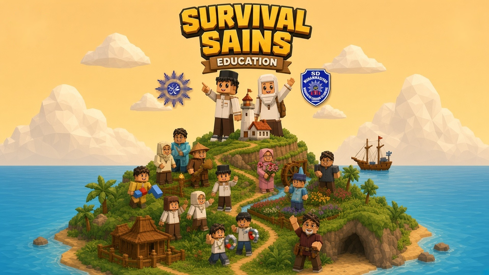

# Survival Sains



Survival Sains adalah game petualangan 3D untuk belajar **IPAS kelas 5 SD/MI, Semester 1**. Game ini
dibuat untuk **Lomba Guru Pembuatan Game Edukasi Berbasis AI bagi Guru Muhammadiyah se-Cabang
Blimbing Dalam Rangka Hari Guru Nasional dan Milad Muhammadiyah (2026)**.

**Main sekarang:** <https://sains-edu.sdmuhwonorejo.com/>

## Identitas karya

| | |
|---|---|
| **Judul** | Survival Sains |
| **Dibuat oleh** | Rosyitania Yudha Astari, S.Pd |
| **Sekolah** | SD Muhammadiyah Wonorejo Polokarto |
| **Jenjang sasaran** | Kelas 5 / Semester 1 |
| **Mata pelajaran** | IPAS (Ilmu Pengetahuan Alam dan Sosial) |
| **Lomba** | Lomba Guru Pembuatan Game Edukasi Berbasis AI bagi Guru Muhammadiyah se-Cabang Blimbing Dalam Rangka Hari Guru Nasional dan Milad Muhammadiyah |
| **Platform AI** | Claude (Anthropic) untuk ide, naskah, kode, dan pengujian |
| **Alamat game** | <https://sains-edu.sdmuhwonorejo.com/> |

### Tujuan pembelajaran

- Memahami dan menganalisis materi/bab IPAS Semester 1 yang meliputi: Sifat Cahaya dan Organ Mata,
  Sifat Bunyi dan Organ Telinga, Ekosistem, Magnet dan Listrik, Kenampakan Lapisan Bumi (Litosfer,
  Hidrosfer, Atmosfer).
- Mengidentifikasi tingkat pemahaman materi melalui game edukatif dan interaktif.

## Cerita

Pemain adalah anggota termuda Kapal Ekspedisi Sains yang terdampar di **Pulau Wonorejo** setelah
badai. Untuk pulang, ia harus menyalakan **Mercusuar Tua** di puncak pulau. Sembilan Penjaga pulau
masing-masing menyimpan bekal ilmu dan satu **alat survival**. Setiap materi IPAS langsung dipakai
untuk bertahan hidup. Cahaya dipakai untuk keluar dari goa dan membuat sinyal, bunyi untuk memanggil
bantuan, magnet untuk membuat kompas, dan listrik untuk menyalakan lampu mercusuar.

Naskah lengkap ada di [`docs/naskah-survival-sains.md`](docs/naskah-survival-sains.md). Naskah ini
dibuat otomatis dari data game dengan `npm run naskah`.

## Materi per balai

Ada 11 balai yang dibuka berurutan mengikuti bab buku. Bab 9 dibagi menjadi tiga balai.

| No | Bab | Materi | Balai | Penjaga | Alat survival |
|---|---|---|---|---|---|
| 1 | Bab 1 | Cahaya dan Mata | Goa Sinar | Mbok Sinar | 🪞 Cermin Sinyal |
| 2 | Bab 2 | Bunyi dan Pendengaran | Lembah Gema | Ki Gaung | 🪘 Kentongan |
| 3 | Bab 3 | Ekosistem | Pondok Tepi Hutan | Nini Rimba | 📒 Buku Catatan Penyintas |
| 4 | Bab 4 | Rantai Makanan | Ladang dan Lumbung | Ki Lumbung | 🧺 Keranjang Bekal |
| 5 | Bab 5 | Simbiosis | Taman Bunga | Nyai Kembang | 🥅 Kelambu Hutan |
| 6 | Bab 6 | Kelestarian Lingkungan | Persemaian | Eyang Wana | 🌱 Bibit Pohon |
| 7 | Bab 7 | Magnet | Bukit Batu Besi | Empu Wesi | 🧭 Kompas Buatan |
| 8 | Bab 8 | Listrik | Sungai Kincir | Mbah Kilat | 🔋 Dinamo Mercusuar |
| 9 | Bab 9a | Litosfer | Tebing Berlapis | Ibu Pertiwi | 🪢 Tali Pendaki |
| 10 | Bab 9b | Hidrosfer dan Atmosfer | Mata Air | Ibu Pertiwi | 🫙 Botol Air Bersih |
| 11 | Bab 9c | Siklus Air dan Bencana | Pos Siaga | Ibu Pertiwi | 🗺️ Peta Jalur Aman |
| Final | Semua bab | 30 soal campuran | Mercusuar Tua | Penjaga tiap lantai | Sertifikat "Penyintas Sains" |

## Alur bermain

1. **Beranda.** Saat game pertama dibuka, muncul popup info karya: pembuat, jenjang, tujuan
   pembelajaran, dan lomba. Popup ditutup dengan tombol ✕.
2. **Sampul, lalu cutscene badai, lalu Kartu Anggota Ekspedisi.** Di sini pemain memilih karakter,
   kostum dan warna, nama, serta mode bermain (sendiri atau kelas).
3. **Prolog di Goa Sinar.** Balai pertama sekaligus menjadi tutorial. Panduan awal menyorot tombol
   satu per satu.
4. **11 balai berurutan** di satu jalur keliling pulau. Balai berikutnya terbuka setelah balai
   sebelumnya lulus. Di peta, kabut di balai yang baru terbuka tersibak dengan animasi.
5. **Pola 6 tahap di setiap balai:**
   1. Pemain tiba di balai.
   2. Penjaga memberi misi lewat percakapan.
   3. Pemain membaca **Halaman Cerita** bersama Cantrik.
   4. Pemain menjawab soal di **Tempat Uji**. Tempat ini baru terbuka setelah cerita dibaca.
   5. Penjaga memberi hadiah alat survival.
   6. Pemain keluar lewat gerbang menuju peta.

   Panah kuning melayang, cincin di tanah, dan panah samar di bawah kaki pemain selalu menunjuk
   tujuan berikutnya.
6. **Final: Malam Badai di Mercusuar Tua.** Ada 30 soal dalam 4 lantai. Pemain lulus bila benar
   minimal 21 soal (70%). Bila belum lulus, cukup mengulang lantai yang belum tuntas. Game ditutup
   dengan epilog dan sertifikat **"Penyintas Sains"**.

## Fitur utama

- **Kuis pilihan ganda di dalam percakapan.** Penjaga mengajukan soal, dan pemain punya 3 hati ❤️
  sebagai 3 nyawa. Jawaban salah memberi petunjuk dan tombol "Ingat cerita" yang membuka adegan
  terkait. Jawaban benar diberi penjelasan dari cerita.
- **Halaman Cerita untuk 11 materi** (44 adegan SVG beranimasi):
  - Benda di gambar bisa diketuk untuk melihat namanya.
  - Benda muncul bergiliran saat adegan dibuka.
  - Gelombang bunyi digambar memancar, dengan warna berbeda untuk infrasonik, audiosonik, dan
    ultrasonik.
  - Kata kunci di narasi ditebalkan, dan kalimat yang sedang dibacakan disorot.
  - Tiap materi ditutup dengan Kunci Ingat, diagram interaktif berikon, ringkasan materi, dan
    hikmah.
- **Narasi suara (TTS)** mengikuti bahasa yang aktif, dengan nada dan kecepatan berbeda per tokoh.
  Teks tetap tampil walau suara dimatikan.
- **Dua bahasa:** Bahasa Indonesia dan English.
- **Nilai keislaman dan kemuhammadiyahan.** Salam di setiap pertemuan, basmalah sebelum tantangan,
  hamdalah setelah lulus, tadabbur alam, manusia sebagai khalifah penjaga bumi, dan ilmu untuk
  menolong sesama.
- **Tas Survival** berisi 11 alat, bintang per balai, dan peta pulau 3D berkabut. Ikon pemain di peta
  memakai karakter dan kostum yang dipilih pemain.
- **Mode kelas (multiplayer)** dengan token 4 digit. Siswa menjelajah sesuai kecepatan
  masing-masing dan saling melihat di balai yang sama. Interaksinya berupa sapaan emoji, tanpa
  obrolan bebas.
- **Dasbor guru** dengan 3 tab:
  - *Kelas:* matriks siswa × 11 balai dan persen benar per bab.
  - *Soal:* soal tersulit dan pilihan salah terbanyak (miskonsepsi).
  - *Siswa:* detail tiap siswa, lama membaca, dan rekomendasi.

  Hasil bisa diekspor sebagai **CSV Kelas** dan **CSV Jawaban**. CSV Jawaban berisi satu baris per
  jawaban, untuk analisis butir soal.
- **Nyaman di HP.** Ada kontrol sentuh dan joystick, serta mode ringan otomatis untuk HP dengan RAM
  kecil. Game bisa dipasang sebagai PWA dan dimainkan offline untuk mode sendiri.
- **Tampilan seragam.** Semua jendela berbentuk kartu ditutup dengan tombol ✕ di pojok kanan atas.

## Mode Guru

Guru membuka `/modeguru/` (mis. <https://sains-edu.sdmuhwonorejo.com/modeguru>), membuat sesi, lalu
membagikan token 4 digit. Token juga bisa ditampilkan di layar **Proyektor** beserta kode QR.

- **Penilaian.**
  - Nilai resmi diambil dari percobaan pertama.
  - Jawaban benar di kesempatan ke-1, ke-2, dan ke-3 bernilai 1, 0,5, dan 0,25.
  - Bintang balai: skor 3,0 = 3★, skor ≥2 = 2★, skor ≥1 = 1★. Satu bintang sudah membuka balai
    berikutnya.
  - Nilai akhir 0–100 = 60% rata-rata balai + 40% Final.
  - KKM bawaan 70. Guru bisa mengubahnya di dasbor, dan nilainya tersimpan di browser guru.
- **Kendali kelas:** kunci kelas, jeda semua, pengumuman, ubah nama, keluarkan siswa, dan akhiri
  sesi. Kendali ini butuh kunci rahasia yang otomatis tersimpan di browser guru. Saat sesi diakhiri,
  ringkasan dan CSV terunduh otomatis.
- **Server restart.** Dasbor membangun ulang ruang kelas memakai token, kunci, dan salinan data siswa
  dari browser guru. Siswa tersambung ulang otomatis dan mengirim ulang progresnya.
- Melihat dasbor hanya butuh token, karena belum ada PIN. Jangan bagikan token ke luar kelas.

Mode Guru tidak ditampilkan di beranda siswa.

## Privasi

Mode sendiri tidak mengirim data ke mana pun. Progres disimpan di perangkat. Mode kelas mengirim nama
panggilan, posisi, dan ringkasan belajar ke server kelas selama sesi. Data ini disimpan di memori
server dan tidak dibagikan ke pihak ketiga. Guru dianjurkan meminta siswa memakai nama panggilan.

## Dokumen pendukung

- [`docs/deskripsi-karya.md`](docs/deskripsi-karya.md): deskripsi karya untuk lomba
- [`docs/jurnal-ai.md`](docs/jurnal-ai.md): jurnal pemanfaatan AI
- [`docs/naskah-survival-sains.md`](docs/naskah-survival-sains.md): naskah lengkap
- [`Bank_Soal_IPA_Kelas5_SD.md`](Bank_Soal_IPA_Kelas5_SD.md): bank soal dan materi
- [`docs/atribusi.md`](docs/atribusi.md): lisensi dan atribusi aset

---

## Untuk Pengembang

### Menjalankan

```bash
npm install
npm run dev        # Vite (:5173) + server multiplayer (:8787)
npm run build      # build produksi (dist/)
npm run serve      # satu server menyajikan game + multiplayer + dasbor guru (:8787)
npm test           # uji unit Vitest
npm run verify:bank
npm run lint
npm run smoke      # uji asap 1 balai penuh di layar HP (butuh server berjalan)
npm run smoke:guru # uji asap Mode Guru (setelah npm run build)
node scripts/smoke-multiplayer.mjs   # uji guru + 2 siswa (butuh `npm run serve`)
```

Port bisa diganti: `PORT=9000 npm run serve` atau `npx vite --port 5180`.

Di hosting statis tanpa fallback SPA, halaman `public/modeguru/index.html` meneruskan ke
`?mode=guru`. Alamat `#modeguru` juga bisa dipakai.

### Hosting

Server hanya butuh Node dan WebSocket. Pakai build command `npm install && npm run build` dan start
command `npm run serve`. Tanpa server, game tetap berjalan penuh dalam mode sendiri.

### Struktur proyek

```
src/
├─ main.ts               # alur utama: peta, dunia balai, misi, hadiah, tas
├─ data/cerita.ts        # naskah: 9 penjaga, cantrik, alat, dialog, Final, epilog
├─ data/adegan.ts        # Halaman Cerita: 44 adegan (benda bernama, gelombang bunyi) + interaksi
├─ data/balai.ts         # materi, diagram (bagian berikon), urutan jalur
├─ core/                 # state (misi, kunci berurutan), engine soal, suara (TTS), bahasa, analisis guru
├─ i18n/en/              # terjemahan Bahasa Inggris
├─ ui/percakapan.ts      # kotak percakapan bergaya visual novel
├─ ui/tantangan.ts       # kuis di dalam percakapan (hati nyawa, petunjuk, catatan jawaban)
├─ ui/halamanCerita.ts   # buku cerita bergerak (ketuk benda, sorot kata kunci)
├─ ui/modal.ts           # aturan satu modal + tombol ✕ kartu
├─ ui/panduan.ts         # panduan awal (sorotan tombol bertahap)
├─ ui/cutscene.ts        # cutscene badai & epilog
├─ ui/screens/           # intro (popup info), final, guru, hasil, petunjuk, tentang
└─ world/                # peta pulau 3D (kabut tersibak), dunia balai 3D (panah kaki), karakter
server/ shared/ tests/ scripts/ docs/
```

## Lisensi & atribusi

Lihat [`docs/atribusi.md`](docs/atribusi.md).
