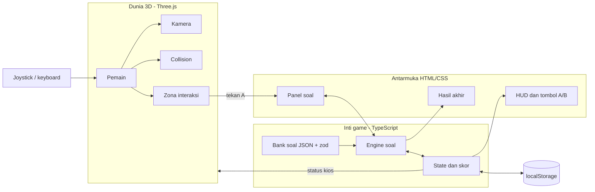
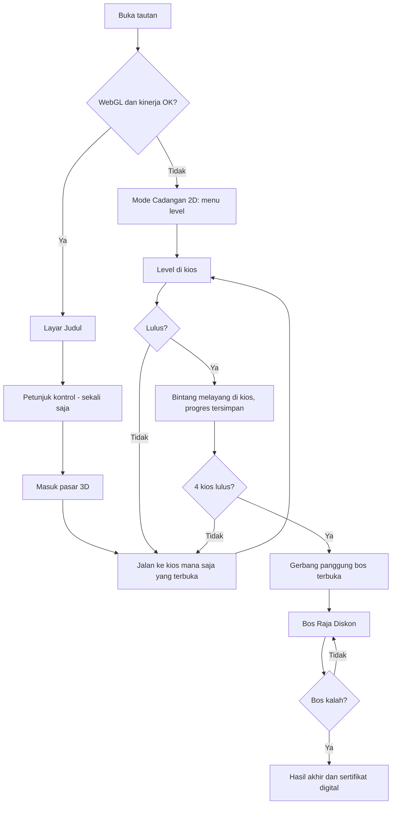
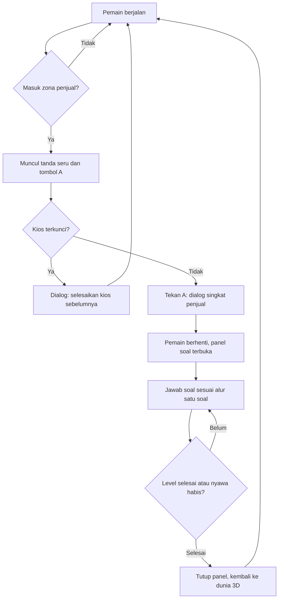
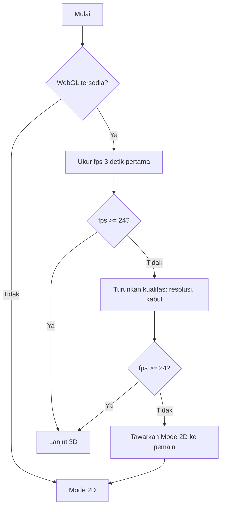

> **ARSIP — dokumen perencanaan awal, tidak lagi menggambarkan karya yang dikirim.**
> Karya akhir berjudul **"Petualangan di Pasar"** (16 balai TKA / 3 zona, tanpa Mode 2D,
> babak puncak Pasar Ramai 30 soal). Lihat `docs/arsip/README.md`.

# PRD v2 — "Pasar Amanah 3D" (Game Edukasi Matematika, Eksplorasi 3D)

> Menggantikan versi 2D pada `prd-game-matematika-toko.md` untuk bagian tampilan, kontrol, tech stack, flow, dan jadwal.
> **Bagian yang tetap berlaku dari file tersebut:** tujuan pembelajaran (bagian 1), aturan main (bagian 5), skema data soal (bagian 10), dan bank soal (bagian 11).
> Batas kumpul: **10 November 2026**.

---

## 1. Konsep

Siswa berjalan di **pasar 3D bergaya low-poly** dengan kamera orang ketiga (seperti game eksplorasi sederhana). Di pasar ada beberapa kios berisi penjual. Siswa menghampiri penjual, menekan tombol **A**, lalu menerima misi matematika. Setelah semua kios selesai, gerbang tengah terbuka dan **Raja Diskon** (bos penalaran) menunggu di panggung pasar.

**Prinsip desain terpenting:** dunia 3D hanya dipakai untuk **berjalan dan memilih misi**. Soal tetap tampil sebagai **panel HTML 2D di atas layar**. Ini membuat mesin soal sama dengan versi 2D, mudah diuji, dan ringan di HP.

| Kios (level)        | Penjual         | Materi                                              |
| ------------------- | --------------- | --------------------------------------------------- |
| 1. Kasir Cilik      | Bu Kasir        | Total belanja dan kembalian                         |
| 2. Pecahan & Diskon | Pak Timbang     | Pecahan, persen, diskon                             |
| 3. Detektif Data    | Papan Penjualan | Tabel dan diagram batang (papan 3D di dinding kios) |
| 4. Cerita Dagang    | Bu Sari         | Soal cerita bertingkat                              |
| Bos                 | Raja Diskon     | Penalaran: banding dan simpulkan                    |

Nilai karakter: tema **amanah dan jujur dalam berdagang** (timbangan tidak dikurangi, kembalian dihitung benar), muncul sebagai dialog singkat penjual.

---

## 2. Lingkup

### Wajib (MVP)

- Satu peta pasar 3D kecil (sekitar 40 × 40 unit) dengan 4 kios dan 1 panggung bos
- Pemain: karakter low-poly dari bentuk dasar, kamera orang ketiga, jalan bebas
- Kontrol sentuh (joystick, geser kamera, tombol A/B) dan kontrol desktop (WASD, mouse, E)
- Interaksi penjual → panel soal HTML
- 4 level + bos, nyawa, koin, bintang, hint, pembahasan, hasil akhir
- Simpan progres di localStorage
- **Mode Cadangan 2D** (peta level berupa menu) jika WebGL gagal atau HP lemah

### Ditunda

- Multiplayer, akun siswa, dasbor guru, server dan basis data
- Karakter beranimasi tulang (skeletal), cuaca, suara 3D posisi

---

## 3. Kontrol

| Aksi               | HP                                       | Desktop         |
| ------------------ | ---------------------------------------- | --------------- |
| Jalan              | Joystick virtual kiri                    | W A S D / panah |
| Putar kamera       | Geser jari di sisi kanan                 | Seret mouse     |
| Interaksi / bicara | Tombol **A** (muncul saat dekat penjual) | E               |
| Hint / menu        | Tombol **B**                             | H / Esc         |

Semua kontrol memakai **Pointer Events + HTML/CSS** (multi-sentuh tanpa plugin).

---

## 4. Kebutuhan Fungsional Tambahan (3D)

| ID    | Kebutuhan                                                                                           | Prioritas  |
| ----- | --------------------------------------------------------------------------------------------------- | ---------- |
| 3D-01 | Render scene Three.js dengan pencahayaan sederhana (ambient + directional) tanpa bayangan real-time | Wajib      |
| 3D-02 | Karakter pemain dari bentuk dasar (kapsul/kubus), bergerak halus                                    | Wajib      |
| 3D-03 | Kamera orang ketiga dengan orbit dan batas sudut                                                    | Wajib      |
| 3D-04 | Tabrakan sederhana (lingkaran pemain vs kotak kios dan pagar)                                       | Wajib      |
| 3D-05 | Zona interaksi di tiap penjual, memunculkan tombol A dan tanda seru                                 | Wajib      |
| 3D-06 | Panel soal HTML terbuka saat interaksi; pemain berhenti bergerak                                    | Wajib      |
| 3D-07 | Penanda status kios: terkunci, sedang aktif, selesai (bintang melayang)                             | Wajib      |
| 3D-08 | Gerbang bos terkunci sampai 4 kios lulus                                                            | Wajib      |
| 3D-09 | Papan data 3D di Level 3 (tekstur dari kanvas) + panel soal HTML                                    | Wajib      |
| 3D-10 | Deteksi WebGL dan kinerja; otomatis beralih ke Mode Cadangan 2D                                     | Wajib      |
| 3D-11 | Mini-peta atau panah penunjuk ke kios berikutnya                                                    | Disarankan |
| 3D-12 | Efek partikel/animasi kecil saat jawaban benar                                                      | Opsional   |
| 3D-13 | Model glTF berlisensi bebas (mis. CC0) dengan atribusi                                              | Opsional   |

## 5. Kebutuhan Non-Fungsional

- **Kinerja HP:** target ≥ 30 fps di HP kelas menengah; batasi `devicePixelRatio` maks 1,5–2; tanpa bayangan real-time; kabut untuk menyembunyikan batas peta; geometri digabung/instancing bila perlu; total aset < 10 MB.
- **Ukuran:** muat awal < 5 detik di jaringan biasa.
- **Keterbacaan:** teks soal selalu di panel HTML (bukan teks 3D) agar tajam dan mudah dibaca.
- **Privasi:** tanpa data pribadi siswa; nama pemain berupa panggilan, disimpan lokal.
- **Aksesibilitas:** tombol ≥ 44 px, opsi kurangi gerakan kamera, tombol bisu.

---

## 6. Tech Stack (dari tabel Anda)

| Lapisan        | Keputusan                                   | Catatan                                                                             |
| -------------- | ------------------------------------------- | ----------------------------------------------------------------------------------- |
| Klien game     | ✅ **Three.js 0.182+**                      | Scene 3D, kamera orang ketiga                                                       |
| Bahasa         | ✅ **TypeScript 5.x**                       | Tipe soal dan state                                                                 |
| Build          | ✅ **Vite 7.x**                             | Hasil build statis                                                                  |
| Kontrol sentuh | ✅ **Pointer Events + HTML/CSS**            | Joystick, geser kamera, tombol A/B                                                  |
| Peta           | ⚠️ **Tiled ditunda**                        | Untuk 4 hari, posisi kios dan collision cukup didefinisikan di file TS/JSON sendiri |
| Model          | ✅ **Bentuk dasar Three.js**                | Tanpa unduhan model; glTF hanya jika sempat                                         |
| Validasi soal  | ✅ **zod 4.x**                              | Validasi bank soal JSON                                                             |
| PWA            | ✅ **vite-plugin-pwa**                      | Opsional                                                                            |
| Uji            | ✅ **Vitest**                               | Logika skor, nyawa, jawaban, collision                                              |
| Lint/format    | ✅ **ESLint + Prettier**                    |                                                                                     |
| Repositori     | ✅ **GitHub privat**                        | `main` + `dev`                                                                      |
| Hosting        | ✅ **Situs statis HTTPS**                   | GitHub Pages / Netlify / Cloudflare Pages                                           |
| Dasbor guru    | ⏸ React, Router, TanStack Query             | Fase lanjutan                                                                       |
| API/DB         | ⏸ Node, Fastify, Drizzle, SQLite/PostgreSQL | Fase lanjutan                                                                       |
| Realtime       | ⏸ Colyseus                                  | Fase lanjutan                                                                       |
| Server         | ⏸ Nginx, PM2, Let's Encrypt                 | Tidak perlu                                                                         |
| E2E            | ⏸ Playwright                                | Uji manual di 3 perangkat                                                           |

---

## 7. Arsitektur dan Struktur Proyek

```
pasar-amanah-3d/
├─ index.html
├─ src/
│  ├─ main.ts                 # titik masuk, deteksi WebGL
│  ├─ core/                   # state, engine soal, scoring (sama dengan versi 2D)
│  ├─ world/
│  │  ├─ scene.ts             # renderer, lampu, kabut
│  │  ├─ player.ts            # gerak, rotasi
│  │  ├─ camera.ts            # orbit orang ketiga
│  │  ├─ collision.ts         # lingkaran vs kotak
│  │  ├─ market.ts            # pembuatan kios dari bentuk dasar
│  │  ├─ npcs.ts              # penjual dan Raja Diskon
│  │  └─ mapConfig.ts         # posisi kios, zona interaksi
│  ├─ input/                  # joystick, geser kamera, keyboard
│  ├─ ui/                     # panel soal, HUD, tombol A/B, hasil
│  ├─ fallback2d/             # Mode Cadangan (menu level)
│  ├─ data/                   # schema.ts, questions/*.json
│  └─ styles/
├─ tests/
└─ docs/                      # jurnal AI, deskripsi karya, atribusi
```



---

## 8. Flow

### 8.1 Alur Utama



### 8.2 Interaksi Kios



Alur satu soal dan alur bos dua tahap sama seperti pada `prd-game-matematika-toko.md` (bagian 12.2 dan 12.3).

### 8.3 Fallback Kinerja



---

## 9. Rencana Kerja Realistis (6–10 November 2026)

Strategi: **bangun inti soal dulu, lalu bungkus dengan dunia 3D.** Dengan begitu selalu ada versi yang bisa dikumpulkan.

| Hari                  | Fokus                                                                                                         | Keluaran                                      | Titik periksa                                                                                                    |
| --------------------- | ------------------------------------------------------------------------------------------------------------- | --------------------------------------------- | ---------------------------------------------------------------------------------------------------------------- |
| **Jum 6 Nov**         | Setup Vite+TS, skema zod, engine soal, panel soal HTML, bank soal Level 1–2, **Mode Cadangan 2D**             | Level 1–2 bisa dimainkan lewat menu           | ✅ Versi aman sudah ada                                                                                          |
| **Sab 7 Nov**         | Scene Three.js, pemain, kamera, joystick, collision, 4 kios dari bentuk dasar, zona interaksi                 | Bisa berjalan di pasar dan membuka panel soal | 🚦 **Go/No-go (malam):** jika jalan di HP belum mulus, bekukan 3D ke versi paling sederhana (kamera tetap/ikuti) |
| **Min 8 Nov**         | Level 3 dan 4, papan data 3D, status kios, gerbang bos, panggung bos                                          | Alur penuh judul sampai tamat                 |                                                                                                                  |
| **Sen 9 Nov**         | Polesan (warna, NPC, bintang melayang), optimasi, uji 3 perangkat, Vitest, deploy, deskripsi karya, Jurnal AI | Tautan siap                                   |                                                                                                                  |
| **Sel 10 Nov (pagi)** | Uji tautan dengan akun lain, tanda tangan pernyataan, kirim                                                   | **Terkumpul**                                 |                                                                                                                  |

Jika titik periksa Sabtu malam gagal, **jangan menambah fitur 3D**; arahkan tenaga ke polesan Mode 2D dan kirim itu sebagai karya utama dengan 3D sebagai bonus.

---

## 10. Pemetaan ke Rubrik Juri

| Aspek (bobot)         | Pemenuhan                                                             |
| --------------------- | --------------------------------------------------------------------- |
| Tujuan & materi (20%) | Tujuan terukur, soal sesuai jenjang, pembahasan benar                 |
| Kreativitas (20%)     | Pasar 3D bisa dijelajahi, misi per kios, bos penalaran dua tahap      |
| Pemanfaatan AI (15%)  | Jurnal prompt, bukti revisi, verifikasi manual kunci jawaban dan kode |
| Desain visual (15%)   | Gaya low-poly konsisten, warna hangat, teks soal tajam di panel HTML  |
| Interaktivitas (10%)  | Kontrol sentuh/desktop, umpan balik instan, mode cadangan bila lambat |
| Kualitas soal (10%)   | Sekitar 37 soal bervariasi dengan pembahasan                          |
| Kemudahan (5%)        | Petunjuk kontrol singkat, tanda seru dan tombol A yang jelas          |
| Orisinalitas (5%)     | Soal dan dunia buatan sendiri; atribusi bila memakai aset luar        |

## 11. Risiko dan Mitigasi

| Risiko                       | Mitigasi                                                                                    |
| ---------------------------- | ------------------------------------------------------------------------------------------- |
| 3D lambat/panas di HP juri   | Batasi resolusi, tanpa bayangan, kabut, deteksi fps, Mode 2D otomatis                       |
| Waktu tidak cukup            | Inti soal dibangun lebih dulu; titik periksa Sabtu malam; bentuk dasar, bukan model unduhan |
| Kontrol sentuh canggung      | Joystick dengan zona mati, sensitivitas kamera dapat diatur, uji di HP asli sejak Sabtu     |
| Kunci jawaban salah          | Hitung manual, uji Vitest untuk soal hitungan                                               |
| Aset luar bermasalah lisensi | Pakai bentuk dasar; bila memakai glTF, hanya CC0 dan catat atribusi                         |
| Data siswa masuk ke AI       | Jangan masukkan nama atau data murid ke prompt                                              |
| Juri tidak sempat menjelajah | Tombol "Langsung ke misi" (teleport ke kios) di menu                                        |

## 12. Checklist Kepatuhan Juknis

- [ ] Judul, pembuat, jenjang, tujuan pembelajaran tampil di game
- [ ] Petunjuk bermain/kontrol ada
- [ ] Interaksi, tantangan, umpan balik, hasil akhir ada
- [ ] Materi akurat, kunci jawaban diverifikasi
- [ ] Tautan publik, diuji dengan akun/peramban lain
- [ ] Deskripsi karya, Jurnal Penggunaan AI, daftar atribusi
- [ ] Surat pernyataan orisinalitas ditandatangani
- [ ] Tanpa data pribadi murid dan tanpa konten terlarang
