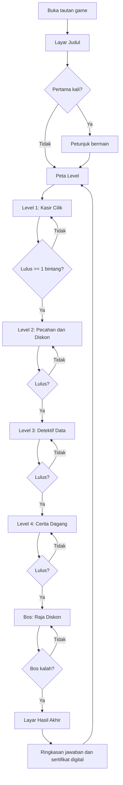
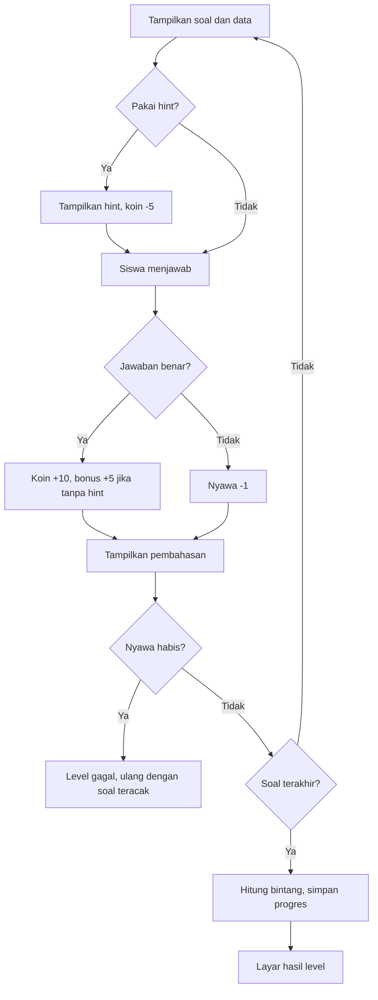
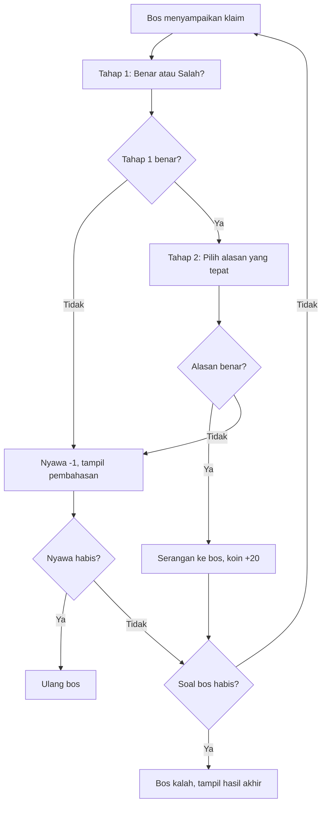
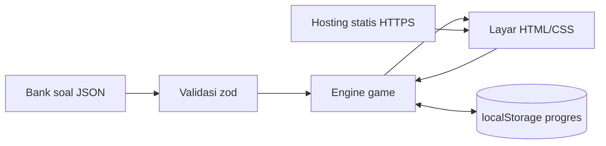

> **ARSIP — dokumen perencanaan awal, tidak lagi menggambarkan karya yang dikirim.**
> Karya akhir berjudul **"Petualangan di Pasar"** (16 balai TKA / 3 zona, tanpa Mode 2D,
> babak puncak Pasar Ramai 30 soal). Lihat `docs/arsip/README.md`.

# PRD & Flow — "Misi Toko Pintar" (Game Edukasi Matematika Berbasis AI)

> Untuk Lomba Pembuatan Game Edukasi Berbasis AI — Guru Muhammadiyah se-Cabang Blimbing 2026
> Status: Draf 1 · Batas kumpul: **10 November 2026**

---

## 1. Ringkasan Produk

**Misi Toko Pintar** adalah game web berbasis misi di sebuah toko/pasar. Siswa berperan sebagai "Asisten Toko" yang menyelesaikan tugas hitung-hitungan sehari-hari: kembalian, pecahan, persen/diskon, membaca grafik/tabel, dan soal cerita bertingkat. Di akhir permainan ada **Bos Penalaran** yang menguji kemampuan bernalar, bukan sekadar menghitung.

**Asumsi (ubah jika perlu):** jenjang sasaran **kelas 6 SD/MI** (bisa dipakai kelas 7 SMP/MTs sebagai pengayaan). Konteks untuk persiapan **Tes Kemampuan Akademik (TKA)** bagian numerasi.

### Tujuan Pembelajaran
Setelah bermain, siswa mampu:
1. Menghitung total belanja dan kembalian dengan operasi bilangan cacah/desimal sederhana.
2. Menyelesaikan penjumlahan/pengurangan pecahan dan menghitung persen (diskon).
3. Membaca dan menafsirkan data dari tabel dan diagram batang.
4. Menyelesaikan soal cerita multi-langkah.
5. Menalar dan membandingkan dua situasi (mis. dua tawaran diskon) disertai alasan.

### Nilai Karakter (selaras Muhammadiyah)
Tema kejujuran dan amanah dalam berdagang (tidak mengurangi timbangan, kembalian dihitung jujur), muncul sebagai narasi singkat antar level.

---

## 2. Tujuan dan Metrik Keberhasilan

| Tujuan | Metrik | Target |
|---|---|---|
| Game berjalan lancar di HP dan laptop | Tidak ada error saat uji di 3 perangkat | 0 bug kritis |
| Siswa paham cara main tanpa pendampingan | Waktu sampai soal pertama | < 30 detik |
| Soal akurat | Semua kunci jawaban diverifikasi manual | 100% |
| Siap dinilai juri | Berkas lengkap (tautan, deskripsi, jurnal AI, pernyataan) | Lengkap sebelum 10 Nov |

---

## 3. Pengguna

| Persona | Kebutuhan |
|---|---|
| **Siswa kelas 6** (pemain utama) | Seru, instruksi singkat, umpan balik langsung, tidak membosankan |
| **Guru** (pembuat & penggunna) | Bisa dipakai di kelas lewat tautan, soal bisa ditambah lewat file JSON |
| **Juri** | Buka tautan, langsung main, paham tujuan dan fungsi game |

---

## 4. Lingkup

### MVP (wajib selesai sebelum 10 November)
- 4 level + 1 Bos Penalaran
- Skor, bintang, nyawa, hint, pembahasan
- Layar judul, petunjuk, hasil akhir, ringkasan jawaban
- Progres tersimpan di perangkat (localStorage)
- Responsif HP/laptop; bisa dipasang sebagai PWA

### Ditunda (setelah lomba)
- Dasbor guru, akun siswa, basis data server
- Multiplayer realtime
- Peta 3D penuh dan kamera third-person

---

## 5. Struktur Game

| Level | Nama | Materi | Jumlah soal | Tipe soal |
|---|---|---|---|---|
| 1 | Kasir Cilik | Total belanja dan kembalian | 5 | Isian angka, drag uang |
| 2 | Pecahan & Diskon | Pecahan, persen, diskon | 5 | Pilihan ganda, isian |
| 3 | Detektif Data | Membaca tabel dan diagram batang | 5 | Pilihan ganda, isian |
| 4 | Cerita Dagang | Soal cerita bertingkat (2–3 langkah) | 5 | Isian, urutan langkah |
| **Bos** | Raja Diskon | Penalaran: banding dan simpulkan | 3 | Benar/Salah + alasan, pilihan ganda |

### Aturan Main
- **Nyawa:** 3 per level. Salah = −1. Habis nyawa → ulang level (soal diacak dari bank soal).
- **Koin:** +10 per jawaban benar, +5 bonus jika tanpa hint.
- **Hint:** maks 1 per soal, biaya 5 koin.
- **Bintang level:** 5 benar = ⭐⭐⭐, 4 = ⭐⭐, 3 = ⭐, <3 = ulang.
- **Bos:** 3 soal penalaran, 3 nyawa. Mengalahkan bos = tamat + sertifikat digital (nama, skor, bintang).
- **Pembahasan:** tampil setiap soal selesai (benar maupun salah), singkat dan langkah demi langkah.
- **Level terkunci** sampai level sebelumnya lulus (≥ 1 bintang).

### Fitur Khas (Kreativitas)
- **Mesin kasir interaktif** (Level 1): siswa menyeret uang untuk menyusun kembalian.
- **Papan diskon** dengan label harga coret (Level 2).
- **Grafik penjualan toko** yang dibuat otomatis dari data soal (Level 3).
- **Bos "Raja Diskon"** yang membuat dua klaim; siswa memilih klaim yang benar beserta alasannya.

---

## 6. Kebutuhan Fungsional

| ID | Kebutuhan | Prioritas |
|---|---|---|
| FR-01 | Layar judul memuat judul, nama pembuat, jenjang, tujuan pembelajaran, tombol Mulai & Petunjuk | Wajib |
| FR-02 | Petunjuk bermain singkat (≤ 4 langkah, bergambar) | Wajib |
| FR-03 | Peta level dengan status terkunci/terbuka/bintang | Wajib |
| FR-04 | Mesin soal membaca bank soal dari JSON dan mengacak urutan | Wajib |
| FR-05 | Dukungan tipe soal: pilihan ganda, isian angka, benar/salah+alasan, drag uang | Wajib |
| FR-06 | Umpan balik instan (benar/salah) dengan pembahasan | Wajib |
| FR-07 | Sistem nyawa, koin, hint, dan bintang | Wajib |
| FR-08 | Render tabel dan diagram batang dari data soal (tanpa pustaka grafik) | Wajib |
| FR-09 | Level Bos dengan alur penalaran dua tahap (jawaban → alasan) | Wajib |
| FR-10 | Layar hasil akhir: skor, bintang, ringkasan jawaban benar/salah per level | Wajib |
| FR-11 | Simpan progres di localStorage (dibungkus try/catch) | Wajib |
| FR-12 | Tombol ulang level dan reset progres | Wajib |
| FR-13 | Efek suara sederhana dengan tombol bisu | Opsional |
| FR-14 | PWA: bisa dipasang dan jalan offline | Opsional |
| FR-15 | Halaman "Tentang Karya": catatan penggunaan AI dan atribusi aset | Disarankan |

## 7. Kebutuhan Non-Fungsional

- **Perangkat:** nyaman di layar HP 360 px ke atas; target tombol ≥ 44 px.
- **Performa:** muat < 3 detik di jaringan biasa; total aset < 5 MB.
- **Keterbacaan:** font besar, kontras tinggi, instruksi singkat.
- **Privasi:** tidak ada pengumpulan data pribadi; nama pemain hanya disimpan lokal dan boleh panggilan/inisial.
- **Konten:** bebas dari unsur terlarang pada juknis (bagian H.4); tidak ada iklan.
- **Aksesibilitas dasar:** navigasi keyboard, teks alternatif gambar penting.

---

## 8. Pilihan Tech Stack (dari tabel Anda, disesuaikan kebutuhan)

Alasan utama: waktu hanya sampai 10 November dan juri cukup membuka tautan, sehingga **tidak perlu server, basis data, atau 3D**.

| Lapisan | Keputusan | Catatan |
|---|---|---|
| Bahasa | ✅ **TypeScript 5.x** | Tipe soal dan state game aman |
| Build | ✅ **Vite 7.x** | Dev cepat, hasil build statis |
| Tampilan game | ✅ **HTML + CSS + Pointer Events** | UI 2D, drag uang dan tombol; multi-sentuh bawaan browser |
| Grafik/tabel | ✅ **SVG/CSS buatan sendiri** | Cukup untuk diagram batang, tanpa pustaka |
| Validasi data soal | ✅ **zod 4.x** | Memastikan JSON bank soal valid sebelum dimainkan |
| PWA | ✅ **vite-plugin-pwa** | Opsional, bisa offline dan dipasang |
| Uji unit | ✅ **Vitest** | Uji logika skor, nyawa, dan pengecek jawaban |
| Lint/format | ✅ **ESLint + Prettier** | Konsistensi |
| Repositori | ✅ **GitHub privat** | `main` + `dev` |
| Hosting | ✅ **Situs statis** (GitHub Pages/Netlify/Cloudflare Pages) | Menghasilkan tautan untuk juri |
| 3D | ⏸ **Three.js** ditunda | Terlalu berisiko untuk 4 hari; pakai ilustrasi 2D |
| Peta | ⏸ **Tiled** ditunda | Tidak ada peta eksplorasi di MVP |
| Dasbor guru | ⏸ **React, Router, TanStack Query** ditunda | Fase lanjutan |
| API/DB | ⏸ **Node, Fastify, Drizzle, SQLite/PostgreSQL** ditunda | Progres cukup di localStorage |
| Realtime | ⏸ **Colyseus** ditunda | Tidak ada multiplayer |
| Server | ⏸ **Nginx, PM2, Let's Encrypt** tidak perlu | Hosting statis sudah HTTPS |
| E2E | ⏸ **Playwright** opsional | Cukup uji manual di 3 perangkat |

---

## 9. Struktur Proyek

```
misi-toko-pintar/
├─ index.html
├─ src/
│  ├─ main.ts              # titik masuk, router layar
│  ├─ game/
│  │  ├─ state.ts          # nyawa, koin, bintang, progres
│  │  ├─ engine.ts         # alur level, acak soal, cek jawaban
│  │  └─ scoring.ts        # rumus skor & bintang
│  ├─ screens/             # title, howto, map, level, boss, result, about
│  ├─ components/          # kasir, tabelData, diagramBatang, hint, nyawa
│  ├─ data/
│  │  ├─ schema.ts         # skema zod
│  │  └─ questions/        # level1.json ... boss.json
│  └─ styles/
├─ shared/types.ts
├─ tests/                  # Vitest
├─ docs/                   # jurnal AI, deskripsi karya, atribusi
└─ vite.config.ts
```

---

## 10. Skema Data Soal

```ts
type Question = {
  id: string;                       // "L1-03"
  level: 1 | 2 | 3 | 4 | "boss";
  type: "mcq" | "number" | "tf-reason" | "money-drag";
  prompt: string;                   // teks soal/cerita
  data?: {                          // untuk Level 3
    kind: "table" | "bar";
    labels: string[];
    values: number[];
    unit?: string;
  };
  options?: string[];               // mcq
  answer: number | string;          // kunci
  reasonOptions?: string[];         // tahap alasan di bos
  reasonAnswer?: string;
  hint: string;
  explanation: string[];            // langkah pembahasan
};
```

---

## 11. Contoh Bank Soal (kunci sudah dihitung, tetap verifikasi ulang)

| ID | Level | Soal | Kunci | Pembahasan singkat |
|---|---|---|---|---|
| L1-01 | 1 | Dina membeli 3 buku @ Rp4.500, membayar Rp20.000. Berapa kembaliannya? | **Rp6.500** | 3 × 4.500 = 13.500; 20.000 − 13.500 = 6.500 |
| L1-02 | 1 | Pak Budi membeli beras Rp27.500 dan minyak Rp18.000, membayar Rp50.000. Kembaliannya? | **Rp4.500** | 27.500 + 18.000 = 45.500; 50.000 − 45.500 = 4.500 |
| L2-01 | 2 | Toko punya 3/4 kg gula, terjual 1/2 kg. Sisanya? | **1/4 kg** | 3/4 − 2/4 = 1/4 |
| L2-02 | 2 | Sepatu Rp200.000 diskon 25%. Harga yang dibayar? | **Rp150.000** | 25% × 200.000 = 50.000; 200.000 − 50.000 = 150.000 |
| L2-03 | 2 | Tas Rp80.000 diskon 15%. Harga yang dibayar? | **Rp68.000** | 15% × 80.000 = 12.000; 80.000 − 12.000 = 68.000 |
| L3-01 | 3 | Tabel es teh terjual: Sen 12, Sel 15, Rab 9, Kam 18, Jum 21. Rata-rata per hari? | **15** | Total 75; 75 : 5 = 15 |
| L3-02 | 3 | Data yang sama: selisih penjualan tertinggi dan terendah? | **12** | 21 − 9 = 12 |
| L4-01 | 4 | Bu Sari beli 2 kg apel @ Rp30.000 dan 3 kg jeruk @ Rp20.000. Diskon 10% dari total. Bayar Rp150.000. Kembaliannya? | **Rp42.000** | Total 60.000 + 60.000 = 120.000; diskon 12.000; bayar 108.000; kembalian 150.000 − 108.000 = 42.000 |
| B-01 | Bos | Toko A: tas Rp120.000 diskon 25%. Toko B: tas sama Rp110.000 diskon 20%. Dina berkata, "Diskon lebih besar pasti lebih murah." Benar atau salah? | **Salah** (A = 90.000, B = 88.000; B lebih murah Rp2.000) | Bandingkan harga akhir, bukan hanya persen diskon |
| B-02 | Bos | Pensil dijual paket 3 buah Rp7.500, atau satuan Rp2.800. Mana lebih hemat untuk 3 pensil, dan berapa selisihnya? | **Paket, hemat Rp900** | Satuan 3 × 2.800 = 8.400; 8.400 − 7.500 = 900 |

**Rencana soal total:** 5 per level × 4 + 3 bos = 23 soal tampil; siapkan **8 soal per level** dan **5 soal bos** agar ada variasi saat ulang (sekitar 37 soal).

---

## 12. Flow

### 12.1 Alur Utama Pemain



### 12.2 Alur Satu Soal



### 12.3 Alur Bos Penalaran (dua tahap)



### 12.4 Arsitektur Data (tanpa server)



---

## 13. Rencana Kerja (6–10 November 2026)

| Hari | Fokus | Hasil |
|---|---|---|
| **Jumat 6 Nov** | Setup Vite+TS, skema zod, engine dan state, bank soal Level 1–2 | Level 1–2 bisa dimainkan |
| **Sabtu 7 Nov** | Level 3 (tabel/diagram SVG), Level 4, hint, pembahasan | Level 1–4 lengkap |
| **Minggu 8 Nov** | Bos penalaran, hasil akhir, peta level, simpan progres | Alur penuh dari judul sampai tamat |
| **Senin 9 Nov** | Polesan visual, uji 3 perangkat, Vitest, PWA, deploy, tulis deskripsi karya dan Jurnal AI | Tautan siap dan dokumen terisi |
| **Selasa 10 Nov (pagi)** | Uji tautan dengan akun lain, tanda tangan pernyataan, kirim | **Terkumpul** |

> Catat prompt penting dan hasil revisi **selama bekerja** untuk Jurnal AI (Lampiran 1 juknis). Jangan menyusunnya di hari terakhir.

---

## 14. Pemetaan ke Rubrik Juri

| Aspek (bobot) | Bagaimana game ini memenuhinya |
|---|---|
| Tujuan & materi (20%) | 5 tujuan terukur, soal sesuai kelas 6, pembahasan benar |
| Kreativitas (20%) | Kasir interaktif, papan diskon, bos penalaran dua tahap |
| Pemanfaatan AI (15%) | AI untuk ide, soal, kode, dan debug; jurnal prompt + bukti revisi + verifikasi kunci jawaban manual |
| Desain visual (15%) | Tema toko konsisten, font besar, warna kontras |
| Interaktivitas (10%) | Umpan balik instan, nyawa, hint, navigasi jelas |
| Kualitas soal (10%) | 37 soal bervariasi + pembahasan langkah demi langkah |
| Kemudahan (5%) | Petunjuk 4 langkah, tanpa pendamping |
| Orisinalitas (5%) | Soal dan konteks buatan sendiri, atribusi aset dicantumkan |

---

## 15. Risiko dan Mitigasi

| Risiko | Mitigasi |
|---|---|
| Kunci jawaban salah dari AI | Hitung ulang manual semua soal; tulis tes Vitest untuk soal hitungan |
| Waktu tidak cukup | Pegang MVP; tunda semua item "Ditunda"; efek suara dan PWA opsional |
| Tautan tidak bisa dibuka juri | Hosting statis publik; uji dengan akun/peramban lain |
| Drag uang sulit di HP | Sediakan mode alternatif: ketuk pecahan uang untuk menambah |
| Aset gambar bermasalah lisensi | Pakai ilustrasi buatan sendiri/SVG atau aset berlisensi bebas dan catat atribusi |
| Data siswa masuk ke AI | Jangan pernah memasukkan nama atau data murid ke prompt |

---

## 16. Checklist Kepatuhan Juknis

- [ ] Judul, pembuat, jenjang, tujuan pembelajaran tampil di game
- [ ] Petunjuk bermain ada
- [ ] Interaksi, tantangan, umpan balik, dan hasil akhir ada
- [ ] Materi akurat, kunci jawaban diverifikasi
- [ ] Tautan publik dan sudah diuji
- [ ] Deskripsi karya, Jurnal Penggunaan AI, daftar atribusi
- [ ] Surat pernyataan orisinalitas ditandatangani
- [ ] Tidak ada data pribadi murid dan tidak ada konten terlarang
